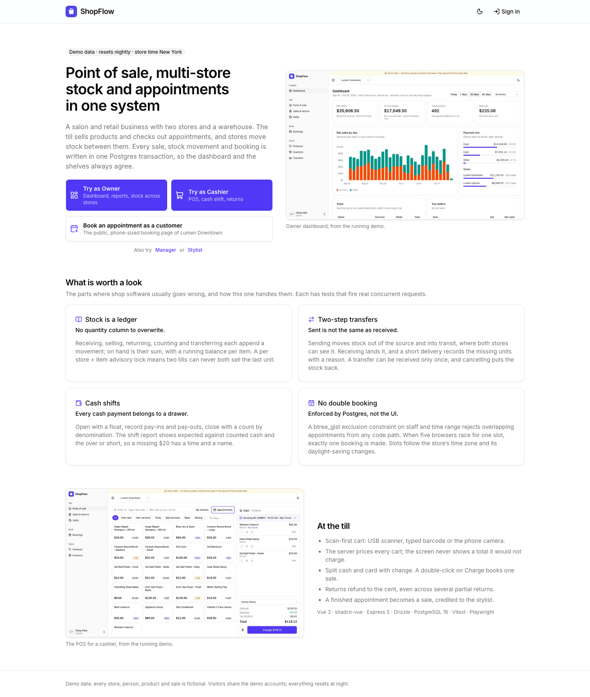
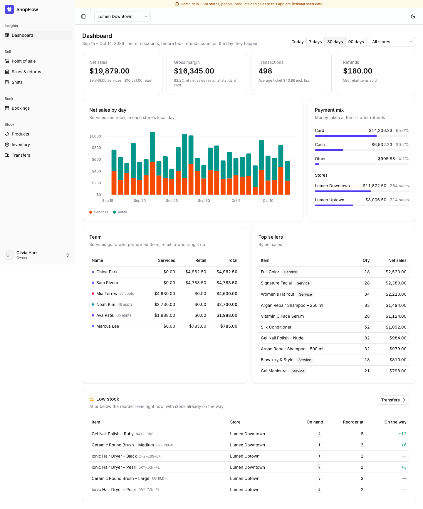
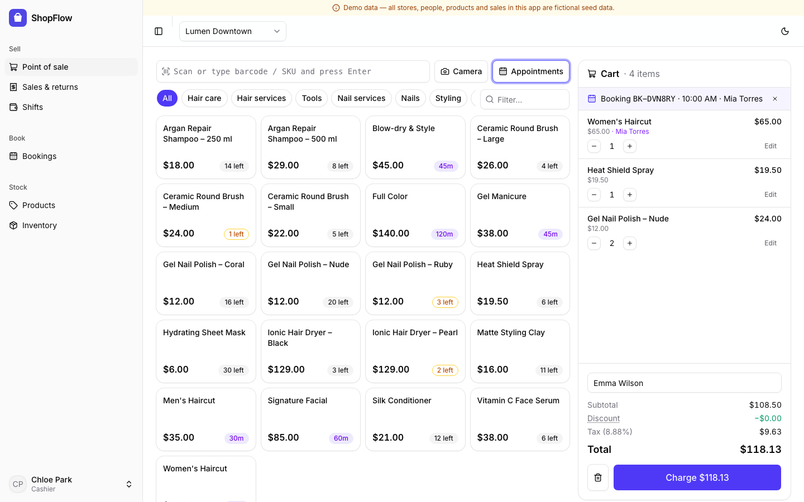
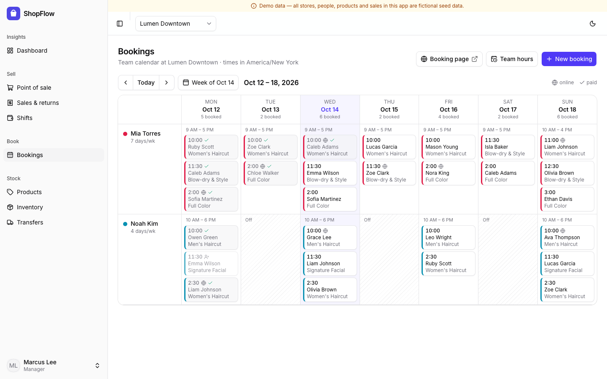
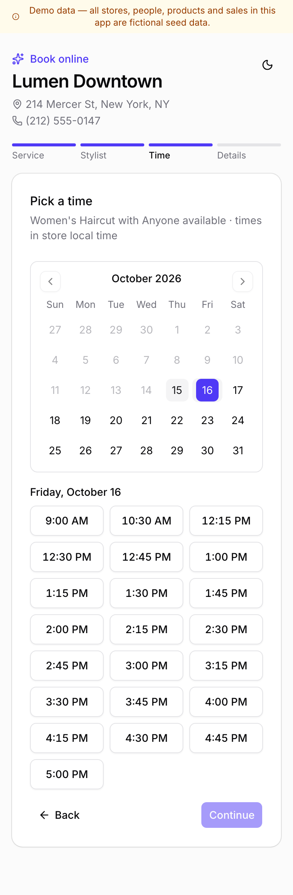

# ShopFlow

Point of sale, multi-store inventory and appointment booking for a salon and retail business. It is one system where a sale, a stock movement and an appointment all meet at the till.

> **Demo data.** Every store, person, product and sale in this app is fictional and comes from `apps/api/src/db/seed.ts`.





| POS checkout of a booking | Week calendar | Online booking (phone) |
| --- | --- | --- |
|  |  |  |

More screens are in [`docs/screenshots`](docs/screenshots), at 1440 px desktop and 390 px phone width.

## Run it

```bash
docker compose up --build
```

- App (web and API in one container): http://localhost:5201
- Public booking page: http://localhost:5201/book/downtown
- API health: http://localhost:5201/api/health
- Postgres: `localhost:5442`

The first start runs migrations and loads the demo dataset into the empty database. Later restarts keep your data. `DEMO_PUBLIC=1 docker compose up --build` starts it the way the hosted demo runs (see below).

| Sign in as | Email | Lands on |
| --- | --- | --- |
| Owner (all stores) | `owner@shopflow.demo` | Dashboard |
| Manager (Downtown + Warehouse) | `manager@shopflow.demo` | Dashboard |
| Cashier (Downtown) | `cashier@shopflow.demo` | POS |
| Cashier (Uptown) | `sam@shopflow.demo` | POS |
| Stylist | `mia@shopflow.demo` | Bookings |

The password for every account is `demo1234`. The landing page and the sign-in page also have one-click buttons for each role.

### Local development

```bash
cp .env.example .env
npm install
npm run db:up        # Postgres only, on port 5442
npm run seed         # migrate + wipe + load demo data
npm run dev:api      # http://localhost:3201
npm run dev:web      # http://localhost:5201 (proxies /api)
```

### Tests

```bash
npm test             # API integration tests on a real Postgres + web unit tests (starts the db if needed)
npm run typecheck
npm run e2e          # Playwright: landing → one-click sign-in; online booking → POS → stock → dashboard (reseeds the dev database)
npm run screenshots  # regenerates docs/screenshots and the landing page images
```

The API tests run against a separate `shopflow_test` database. They make real concurrent requests: two tills race for the last unit, five browsers race for one slot, two clerks receive the same transfer at the same moment.

## Public demo mode

`DEMO_PUBLIC=1` turns a deployment into a shared, public demo:

- **One-click sign-in.** "Try as Owner" and "Try as Cashier" sign in without a password (`POST /api/auth/demo`). The public booking page is linked from the landing and sign-in pages.
- **Locked demo accounts.** The `@shopflow.demo` accounts cannot have their password, email, role or active flag changed (403 `DEMO_LOCKED`). Visitors can still create and edit other users.
- **Tighter per-IP rate limits.** Sign-in is limited to 10 a minute and one-click sign-in to 20 a minute. Public booking is limited to 10 every 10 minutes. Set `TRUST_PROXY` to the number of proxies in front of the app so the limits see the visitor's address.
- **A "today" that is never empty.**
  - The stores keep the New York time zone.
  - Every 5 minutes the app replays a fixed plan of walk-in sales up to the current time. It also checks out appointments that ended 10 minutes ago, and a few become no-shows. All of this goes through the normal POS and booking code.
  - Trading is busiest from 9 am to 8 pm, with a thin trickle overnight, so the first sale lands a few minutes after midnight.
  - Each step is idempotent, and a Postgres advisory lock keeps two runs from overlapping.
- **Nightly reset.** `npm run demo:reset` wipes everything visitors created and reloads four weeks of history up to today. It then fills today up to now.

## Deploying

The image is a single container: Express serves the API and the built web app. It is a multi-stage `node:22-alpine` build, about 66 MB compressed and 200 MB on disk.

```bash
docker buildx build --platform linux/amd64 -t shopflow:latest .
```

On start the container applies migrations and, with `SEED_DEMO=if-empty`, loads the demo data into an empty database. Both steps are safe to repeat on every start.

| Variable | Required | Example | Notes |
| --- | --- | --- | --- |
| `DATABASE_URL` | yes | `postgres://shopflow:…@postgres:5432/shopflow` | ShopFlow needs its **own database**. Its role must own it, because migrations create the `btree_gist` extension and a `drizzle` schema. |
| `JWT_SECRET` | yes | `openssl rand -hex 32` | The app refuses to start without it in production. |
| `DEMO_PUBLIC` | no | `1` | Public demo mode (above). |
| `TRUST_PROXY` | no | `2` | Number of proxies in front: `2` behind Cloudflare and a reverse proxy. Default `1`. |
| `SEED_DEMO` | no | `if-empty` | Loads demo data into an empty database. |
| `WEB_ORIGIN` | no | `https://shopflow.example.com` | CORS origin. The web app is same-origin, so this only matters for other clients. |
| `API_PORT` | no | `3201` | The port the container listens on. |

`deploy/compose.vps.yml` is a sample for a server that already runs a shared Postgres and a reverse proxy:

- It has no database of its own and publishes no host ports.
- It joins the external `portfolio` network, where the proxy reaches `http://shopflow:3201`.
- It includes the nightly reset cron line.

The reset only ever truncates ShopFlow's own tables.

## Features

- **Stores and roles.** Stores and a warehouse; owner, manager, cashier and staff roles; every API call is scoped to the user's stores.
- **Catalog.**
  - Products and services, both with variants.
  - Barcodes: type them, use a USB scanner, or use the phone camera (ZXing).
  - Per-store price overrides.
- **Inventory ledger.**
  - Every change is an immutable movement: receive, sale, return, count adjustment, transfer out and in.
  - On hand is the sum of movements, and the ledger view shows a running balance.
  - Negative stock is refused unless the store opts in.
- **Transfers.**
  - Two steps: send, then receive.
  - Goods in transit are visible to both ends.
  - Partial receipt records the shortfall with a reason.
  - Cancelling a transfer puts the stock back.
- **POS.**
  - Scan-first cart.
  - Line and order discounts (percent or amount).
  - Split payments across cash, card and other, with change.
  - Idempotent charge.
  - Returns with or without restock.
  - 80 mm printable receipt.
- **Shifts.**
  - Opening float, then pay in and pay out.
  - Closing uses a denomination count.
  - The shift report shows expected cash against counted cash and the over or short.
- **Bookings.**
  - Team hours per store and per weekday.
  - Week calendar.
  - Public mobile booking page: service → person or "anyone available" → free slots → details.
  - No double booking, enforced by the database.
  - Check out a booking at the POS, so the appointment becomes the sale.
- **Reports.**
  - Net sales by local store day, by store and by team member.
  - Gross margin, payment mix, top sellers.
  - Low stock, including what is already on the way.
  - Comparison against the previous period.

## What to look at

1. **Stock can't go wrong under concurrency.**
   - `apps/api/src/inventory/ledger.ts:29`: `lockStock` takes a transaction-scoped advisory lock per store+variant, in sorted order to avoid deadlocks.
   - `applyMovements` (`:61`) checks the balance and writes the movement inside that lock.
   - `apps/api/test/pos.test.ts:95`: two cashiers race for the last unit, and exactly one sale succeeds.
2. **Money is integers, and refunds always add up.**
   - `apps/api/src/lib/money.ts:47` `allocate` spreads order discounts and tax with largest-remainder rounding, so line amounts always sum to the total.
   - `refundShare` (`:99`) uses cumulative rounding, so any sequence of partial returns refunds exactly the line amount in total, never a cent more (`pos.test.ts:155`).
3. **Double booking is impossible at the database level, not just in the UI.**
   - `apps/api/drizzle/0003_bookings.sql:60` is a `btree_gist` exclusion constraint on `(staff_id, tstzrange(starts_at, ends_at))` over live bookings.
   - `bookings.test.ts:94` fires simultaneous requests at one slot and exactly one wins.
   - Slot generation in `apps/api/src/booking/booking.ts:65` works in the store's time zone and is safe across daylight-saving changes.
4. **One transaction for a sale, with a fixed lock order.**
   - `createSale` in `apps/api/src/pos/sales.ts:69` takes its locks in this order: shift (FOR SHARE), then booking (FOR UPDATE), then stock locks, then the receipt counter.
   - The same appointment can't be charged by two tills (`bookings.test.ts:174`).
   - A double-click on Charge books one sale, because of `clientRef` idempotency (`pos.test.ts:110`).
5. **Reports that match how a shop owner thinks.**
   - `apps/api/src/reports/reports.ts:22` builds one stream of signed events: sale lines are positive on the sale day, and returns are negative on the refund day.
   - Days are bucketed in each store's local time zone, so an 11 pm sale in New York stays on that day.
   - Services are credited to the stylist and retail to the cashier.

## Stack and why

- **API:** Node 22+, TypeScript, **Express 5**, Drizzle ORM, PostgreSQL 16, zod.
- **Web:** Vue 3, Vite, Pinia, Tailwind CSS v4, **shadcn-vue** (reka-ui) with CSS-variable theming and dark mode, lucide icons, and unovis charts through the shadcn-vue chart component.
- **Tests:** Vitest with supertest against a real Postgres, Vue unit tests, and Playwright.
- **Express over NestJS.** The interesting parts of this domain are transactions and locking, not dependency injection. A small Express app with plain domain modules (`inventory/`, `pos/`, `booking/`, `transfers/`, `reports/`) keeps every SQL statement and lock visible in one place. Routes are thin and validate with zod.
- **Drizzle over Prisma.** It allows raw SQL wherever it matters: advisory locks, `FOR UPDATE`, exclusion constraints, `generate_series` reports. It also keeps typed queries for the rest.

See [docs/ARCHITECTURE.md](docs/ARCHITECTURE.md) for the diagram and design decisions.

## Not included

- **Card payments are recorded, not processed.** The cashier takes the card on a separate terminal and records it as "card". There is no Stripe or terminal integration.
- **Limited scheduling.** There is no customer accounts or notifications (SMS/email), and no time off or holidays for staff. The team-hours editor sets one range per day (the API accepts several).
- **Single currency (USD), one tax rate per store.**
